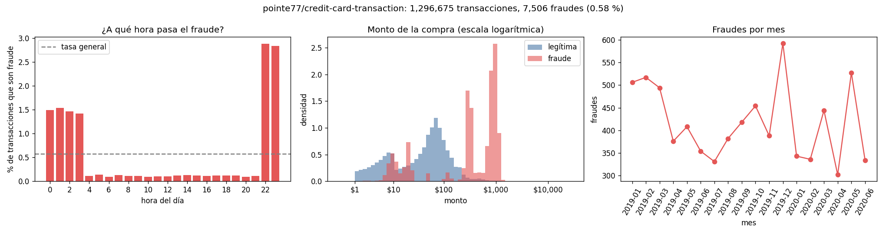
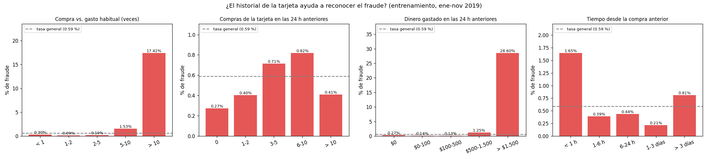
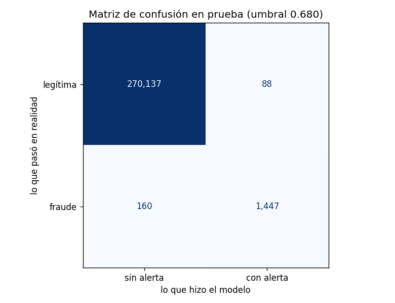
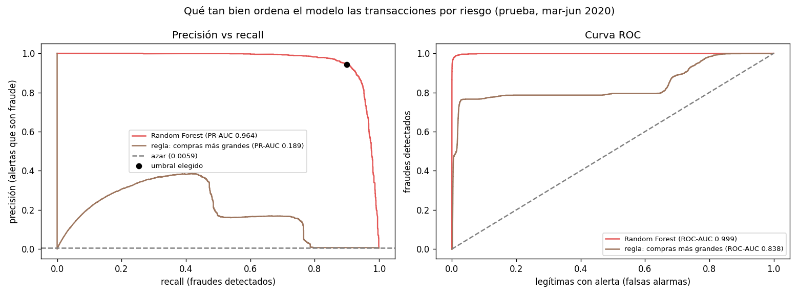
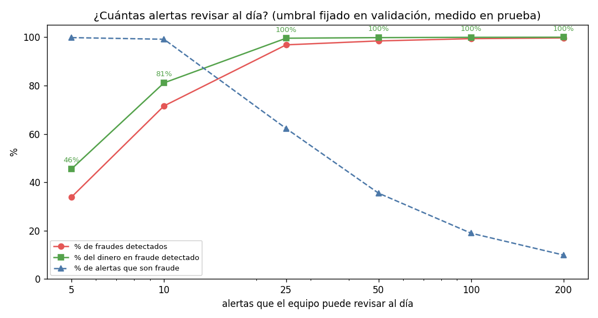
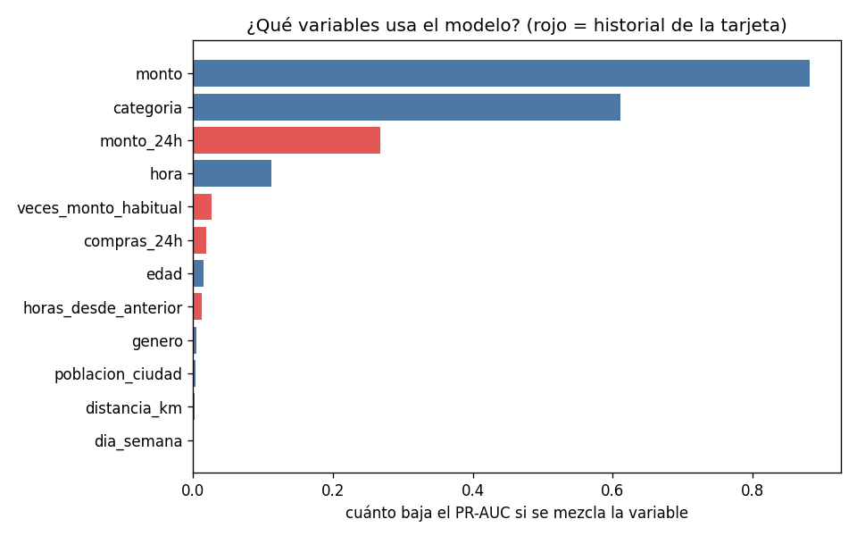

# Hallazgos: ¿qué transacciones revisar primero para frenar el fraude?

**Integrantes:** Jaider Morales Bautista · Aleicer Vesga Rueda · Guillerno Leon Loaiza Mesa

Este documento explica, para el equipo de prevención de fraude, qué encontramos con nuestro modelo y qué recomendamos hacer. Los números salen de la ejecución automática en GitHub Actions. El detalle completo está en [`salidas/resumen_ea3.txt`](salidas/resumen_ea3.txt) y en los demás archivos de [`salidas/`](salidas/).

> **La pregunta:** ¿qué transacciones con tarjeta tienen mayor riesgo de ser fraude, para que el equipo de prevención de fraude decida cuáles bloquear o revisar primero, si solo puede revisar un número limitado de alertas al día?

## La respuesta corta

Nuestro modelo (un Random Forest) le pone a cada transacción una probabilidad de fraude. Si el equipo revisa la lista de arriba hacia abajo, **con unas 14 alertas al día frena 9 de cada 10 fraudes, que equivalen al 95 % del dinero en fraude**. Y casi no molesta a los clientes: **94 de cada 100 alertas son fraude de verdad**.

Las transacciones que más riesgo tienen comparten un patrón muy claro:

- **Montos altos y fuera de lo normal para esa tarjeta.** Un fraude típico es unas 10 veces más grande que lo que esa persona suele gastar.
- **Mucho dinero gastado en poco tiempo.** En las 24 horas anteriores a un fraude, la tarjeta ya había gastado en la mitad de los casos más de $1.600, mientras que en una compra normal ese valor ronda los $160.
- **De noche, entre las 10 p. m. y las 3 a. m.**
- **En ciertas categorías:** compras de mercado presenciales, compras por internet y gastos varios por internet.

Medimos el modelo con cuatro meses (marzo a junio de 2020) que no usamos ni para entrenarlo ni para ajustarlo, como si fueran "transacciones del futuro".

## El problema en números

Revisamos 1.296.675 transacciones de 983 tarjetas, entre enero de 2019 y junio de 2020.

- **El fraude es poco frecuente pero caro.** Solo el 0,58 % de las transacciones son fraude, pero se llevan el 4,4 % del dinero: casi $4 millones. Una compra fraudulenta tiene un monto mediano de $396; una normal, de $47.
- **En los meses de prueba hubo unos 14 fraudes al día** entre unas 2.400 transacciones diarias. Revisarlo todo es imposible; por eso hay que priorizar.

## Hallazgo 1: la hora y el historial de la tarjeta delatan el fraude

Antes de entrenar el modelo miramos los datos con calma. Encontramos dos cosas.

**La hora pesa muchísimo.** A las 10 y 11 p. m. casi el 3 % de las transacciones son fraude. Al mediodía es apenas el 0,1 %: unas 28 veces menos.

**Lo que más ayuda es comparar cada compra con la costumbre de esa misma tarjeta.** Por eso construimos cuatro variables con el historial de cada tarjeta, usando solo compras anteriores para no hacer trampa. La gráfica muestra lo que encontramos:

- Cuando la tarjeta ya gastó **más de $1.500 en las 24 horas anteriores**, el **28,6 %** de las compras son fraude. La tasa normal es 0,59 %, así que es casi 50 veces más.
- Cuando una compra es **más de 10 veces lo que suele gastar la tarjeta**, el **17,4 %** son fraude.
- Cuando pasó **menos de una hora desde la compra anterior**, el fraude casi se triplica.

En la EA2 habíamos dicho que la gran limitación del modelo era no tener el historial del cliente. Aquí lo agregamos, y fue lo que más mejoró los resultados.

## Hallazgo 2: el modelo ordena las alertas casi perfecto

La forma de medir qué tan bien ordena el modelo es el **PR-AUC**. Va de 0 a 1 y mide qué tan arriba de la lista quedan los fraudes. Si el modelo pusiera las transacciones al azar, el PR-AUC sería 0,006, que es la proporción de fraudes. Nuestro modelo obtuvo **0,964**.

Con el umbral que escogimos (0,68), en los 113 días de prueba pasó esto:

| | Cantidad | Qué significa para el banco |
|---|---|---|
| Fraudes con alerta | **1.447 de 1.607 (90 %)** | Fraudes que el equipo alcanza a frenar |
| Fraudes sin alerta | 160 (10 %) | El error más caro: ese dinero se pierde |
| Falsas alarmas | 88 (menos de 1 al día) | Clientes que reciben una llamada o un bloqueo sin razón |
| Alertas al día | 13,6 | Carga diaria para el equipo |
| Dinero en fraude detectado | **95,2 %** | Unos $813.000 de cerca de $854.000 en los cuatro meses |

**¿Y si no usáramos modelo?** Comparamos contra una regla sencilla que podría aplicar cualquier banco: revisar las compras más grandes del día, con la misma cantidad de alertas (13,6 al día). Esa regla solo detecta el **36 %** de los fraudes, y apenas 38 de cada 100 alertas son fraude. El modelo detecta **2,5 veces más fraudes** con el mismo esfuerzo. La gráfica lo muestra: la curva del modelo (roja) va casi pegada a la esquina, mientras que la regla (café) cae muy rápido.

## Hallazgo 3: con unas 25 revisiones al día se frena casi todo

Esta es la parte que responde directamente la pregunta. Calculamos qué pasaría según cuántas alertas pueda revisar el equipo al día. El nivel de corte de cada fila lo fijamos con los meses de validación y lo aplicamos tal cual a los meses de prueba.

| Alertas que el equipo revisa al día | Fraudes frenados | Dinero en fraude frenado | Alertas que son fraude |
|---|---|---|---|
| 5 | 34 % | 46 % | 99,8 % |
| 10 | 72 % | 81 % | 99,1 % |
| **25** | **97 %** | **99,6 %** | **62 %** |
| 50 | 98 % | 99,8 % | 36 % |
| 100 | 99 % | 99,9 % | 19 % |

Lo interesante es que **pasar de 25 a 50 o 100 alertas casi no suma nada**: el 99,6 % del dinero ya se frena con 25. A partir de ahí, cada alerta extra es casi siempre una falsa alarma.

## Hallazgo 4: qué mira el modelo para decidir

Medimos cuánto empeora el modelo si "revolvemos" cada variable al azar. Las que más pesan son:

1. **El monto** de la compra.
2. **La categoría** del comercio.
3. **El dinero gastado por la tarjeta en las últimas 24 horas**, una de nuestras variables de historial.
4. **La hora.**

Variables como el día de la semana, la distancia al comercio o el tamaño de la ciudad casi no aportan.

## Hallazgo 5: dónde falla el modelo

- **Los fraudes que se le escapan son pequeños.** Su monto mediano es $37 y están en línea con lo que la tarjeta gasta normalmente. Por eso se confunden con compras de verdad. Los que sí detecta tienen un monto mediano de $628. Al final, lo que se escapa es apenas el 4,8 % del dinero en fraude.
- **Algunas categorías se le resisten.** En comidas en restaurantes (`food_dining`) solo detecta el 27 % de los fraudes; en salud y gimnasio (`health_fitness`), el 53 %; y en mercado por internet (`grocery_net`) y niños y mascotas (`kids_pets`), cerca del 63 %. Son fraudes de montos bajos y, en total, mueven muy poco dinero: en comidas, menos de $4.000 en cuatro meses. En cambio, en las categorías que más dinero mueven el modelo detecta más del 93 % de los fraudes. Por ejemplo, en mercado presencial (`grocery_pos`) llega al 99,7 % y en compras por internet (`shopping_net`) al 97,2 %.
- **Las falsas alarmas son compras grandes y raras para esa tarjeta.** Tienen un monto mediano de $735 y son unas 18 veces el gasto normal del cliente. Es entendible que el modelo dude con ellas, y son justo las compras que un analista puede confirmar rápido con el cliente.

## ¿Qué tan confiables son estos resultados?

**Lo que nos da confianza:**

- Medimos el modelo con **cuatro meses que nunca vio**, ni para entrenar ni para escoger sus parámetros o el umbral.
- **Comprobamos que no hay fuga de información.** Recalculamos el historial borrando los meses de prueba y los valores no cambiaron (diferencia de 0 sobre más de un millón de filas).
- **El resultado se mantiene mes a mes.** En marzo, abril, mayo y junio el modelo detectó entre el 88,6 % y el 91,1 % de los fraudes, con una precisión de entre 91,8 % y 96,7 %.
- **El modelo no está memorizando.** El PR-AUC en validación (0,963) y en prueba (0,964) son casi iguales, y la diferencia frente al entrenamiento es pequeña (0,037).

**Lo que hay que tener en cuenta:**

- **El dataset es simulado.** Los patrones de fraude probablemente son más limpios que en la vida real, así que en un banco de verdad estas cifras seguramente serían más bajas. Tomamos los resultados como una muy buena señal, no como una promesa.
- **El fraude cambia.** Los estafadores se adaptan, así que un modelo que hoy funciona puede dejar de hacerlo en unos meses si no se reentrena.
- **El umbral lo elegimos con F1,** que pesa igual un fraude perdido y una falsa alarma. Si el banco sabe cuánto le cuesta cada error, el umbral se puede ajustar con la tabla de capacidad.
- **No es directamente comparable con la EA2.** En la EA2 la regresión logística tuvo un PR-AUC de 0,31, pero esa vez dividimos los datos al azar y no teníamos el historial de la tarjeta. Así que la mejora es real, pero no se puede atribuir solo al cambio de algoritmo.

## Recomendaciones

1. **Usar tres niveles según la probabilidad que da el modelo**, en vez de una sola lista:
   - **Probabilidad de 0,89 o más:** bloqueo preventivo y confirmación inmediata con el cliente. Son unas **10 alertas al día**, el **99 % son fraude** y concentran el **81 % del dinero**, así que casi nunca se molesta a un cliente honesto.
   - **Entre 0,31 y 0,89:** revisión manual por un analista. Son unas **12 alertas más al día**. Con los dos niveles juntos se frena el **97 % de los fraudes** y el **99,6 % del dinero**.
   - **Menos de 0,31:** la transacción pasa sin revisión.
2. **Dimensionar el equipo para unas 25 revisiones al día.** Según nuestros resultados, contratar o asignar más analistas casi no mejora el resultado.
3. **Reforzar la revisión de noche.** El fraude se concentra entre las 10 p. m. y las 3 a. m., así que el equipo, o por lo menos el bloqueo automático del primer nivel, tiene que funcionar en ese horario.
4. **No gastar analistas en los fraudes pequeños.** Para compras de bajo monto en comidas, salud o mercado por internet, es mejor una confirmación automática al cliente (por SMS o en la app) cuando la compra se salga de lo normal. Revisarlas a mano costaría más que el dinero que se pierde.
5. **Vigilar el modelo cada mes y reentrenarlo.** Recomendamos medir cada mes qué porcentaje de fraudes se detecta. Si baja de más o menos 85 %, toca reentrenar con los meses más recientes.
6. **Antes de bloquear tarjetas de verdad, hacer un piloto.** La idea es dejar el modelo corriendo un mes con datos reales del banco, solo marcando alertas sin bloquear nada, y comparar con lo que hace hoy el equipo. Así se confirma si los resultados se mantienen fuera de un dataset simulado.
7. **Calcular el costo de cada error.** Saber cuánto cuesta un fraude perdido frente a una falsa alarma (tiempo del analista, cliente molesto) permite mover el umbral con números y no a ojo.
